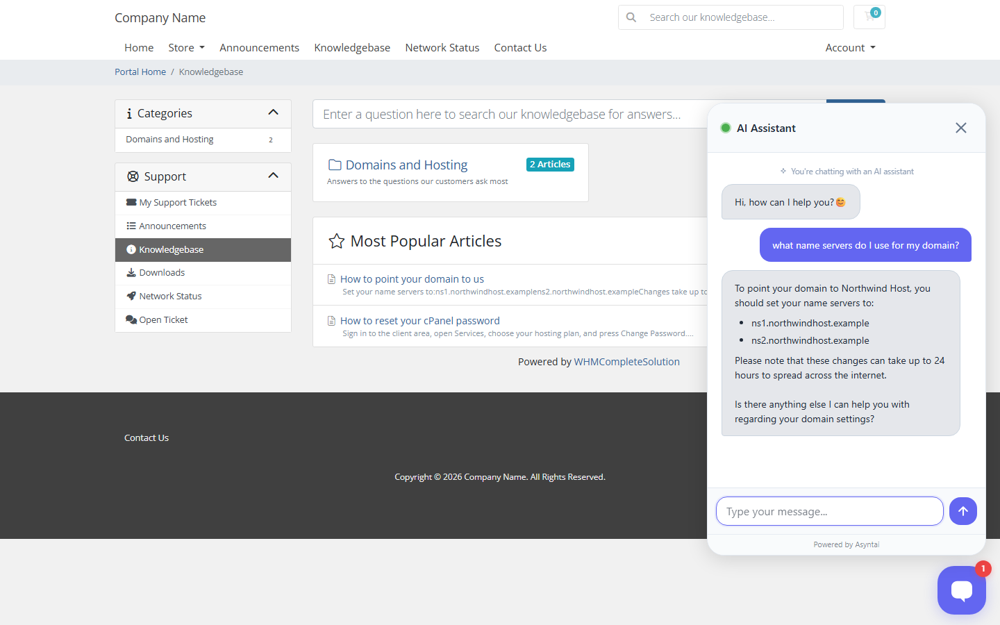
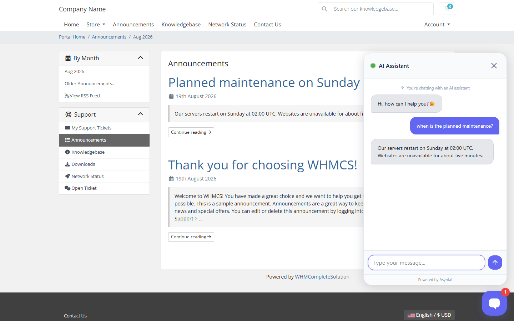

# Asyntai - AI Chatbot for WHMCS

Add an AI assistant to your WHMCS client area in minutes. It answers your customers day and night, in over 30 languages, using your own knowledge base.

This addon module puts the Asyntai chat widget on your client area, order forms and ticket pages, and can send your published WHMCS knowledge base articles and announcements to Asyntai so the answers match what you have already written. **No code to paste, no API key to copy.**

## Why choose Asyntai?

- **It answers from your own content**: your published WHMCS knowledge base articles become the assistant's answers, in your wording.

- **Always available**: customers get an answer at 3am, when nobody is on shift.

- **Fewer tickets**: the assistant sits on the ticket page too, so common questions are answered before a ticket is opened.

- **Works in all languages**: it detects the language of the question and replies in it.

- **Honest**: it says it does not know instead of inventing an answer.

- **Fast pages**: the widget script loads only after the page has finished loading, and the module caches its settings, so a page view never waits for an outside call.

- **See what customers ask**: every conversation is stored in your Asyntai dashboard.

## Requirements

- WHMCS 7.0 or newer
- PHP 7.2 or newer, with the cURL extension
- The server must be able to reach `https://asyntai.com` over HTTPS
- An Asyntai account. Creating one is free, and the free plan works.

## Installation

1. Download or clone this repository.
2. Upload the `asyntai` folder into your WHMCS installation, so that it becomes `/modules/addons/asyntai/`
3. In WHMCS, go to **System Settings > Addon Modules**.
4. Find **Asyntai AI Chatbot** and click **Activate**.
5. Click **Configure**, tick the administrator roles that may use it, and save.

> **Important:** activate the module from System Settings > Addon Modules in the admin area. Activating it any other way leaves WHMCS's own hook cache empty, and the widget then never appears on the client area even though the module looks connected.

## Configuration

1. Open **Addons > Asyntai AI Chatbot**.
2. Click **Connect Asyntai**. Sign in, or create a free account, and choose which website the assistant should answer from.
3. Come back to WHMCS and click **Refresh**. The widget is now live on your client area.

Don't have an account yet? Create a free Asyntai account at [asyntai.com/auth](https://asyntai.com/auth)

### Settings

| Setting | What it does |
| --- | --- |
| Show on client area | Show the widget on client area, order and ticket pages |
| Show to signed out visitors | Also show it before a customer signs in |
| Send knowledge base articles | Send your published articles to Asyntai |
| Send announcements | Also send your published announcements |

## Sending your knowledge base

Open **Addons > Asyntai AI Chatbot** and click **Send articles to Asyntai now**. Run it again after you add or edit articles. Sending the same article twice updates it; it does not create a copy.

Only published items are sent. Private knowledge base articles and unpublished announcements stay in WHMCS.

## What the module sends

The module sends your published knowledge base articles and, if you turn it on, your published announcements. It never sends customer names, invoices, tickets, passwords or any other data from your WHMCS database.

There is no API key in this module. On activation it creates its own random installation token, stored in its own `mod_asyntai` table, and that token is what identifies the installation.

## Removing it

Deactivate the module in **System Settings > Addon Modules**. The widget disappears at once. Your connection is kept, so activating it again needs no further setup. To break the link completely, open your Asyntai dashboard and disconnect WHMCS there.

## Pricing

The module is free. It needs an Asyntai account, which is also free to create, and it works on the Free plan. Paid plans raise the monthly message allowance. See [asyntai.com/pricing](https://asyntai.com/pricing/).

## Documentation and support

- Setup guide: [asyntai.com/documentation/integrations/whmcs/](https://asyntai.com/documentation/integrations/whmcs/)
- All documentation: [asyntai.com/documentation/](https://asyntai.com/documentation/)
- Email: hello@asyntai.com

## License

MIT. See [LICENSE](LICENSE).
